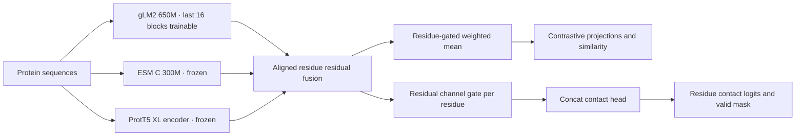

# Piper

**Gated protein language model fusion for residue contact and protein interaction prediction.**

[中文说明](README.zh-CN.md) · [Model card](docs/MODEL_CARD.md) · [Data protocol](docs/DATA_PROTOCOL.md) · [Reproducibility](docs/REPRODUCIBILITY.md) · [Contributing](CONTRIBUTING.md)

Piper is a protein interaction and residue contact prediction model that integrates three protein language models through gated residue representations. It combines gLM2 with frozen ESM C 300M and ProtT5 XL, uses learned residue weights for contrastive pooling, and applies residual channel gating before the residue-level concat contact head. The primary evaluation target is **residue Contact P@K**, reported separately at 12 Å and 8 Å.

**Status:** research code, version 0.1.0. Training is ongoing; a final Piper checkpoint has not yet been released.

## Architecture



The current model keeps one representation per residue. Window-3/stride-2 patch metrics are diagnostics; **training does not pool contact labels into patches**. Unknown structural positions and padding are excluded from supervision.

## Installation

Tested with Linux, Python **3.12**, PyTorch **2.8.0 + CUDA 12.8**, Transformers **4.48.1**, and `esm==3.2.3`. Use a fresh environment, separate from any running training job.

```bash
git clone git@github.com:huangyao110/Piper.git
cd Piper
python3.12 -m venv .venv
source .venv/bin/activate
python -m pip install torch==2.8.0 torchvision==0.23.0 --index-url https://download.pytorch.org/whl/cu128
python -m pip install -r requirements.txt
python -m pip install --no-deps -e .
python -m pip check
piper --help
```

`requirements.txt` is the single installation list for training, prediction, data preparation and tests. The [historical environment snapshot](docs/ENVIRONMENT_REFERENCE.json) preserves installed package versions for provenance; it is not another installation file. PyTorch wheels are selected separately above so CPU and CUDA environments can use the same requirements.

Run commands from this source checkout: training records source files and protocol locks relative to the repository. The editable installation is the supported workflow. Data preparation additionally requires the **exact locked MMseqs binary**, not merely a matching version string. Full training needs CUDA and the external assets described below. CPU tests do not require pretrained weights.

## Data and pretrained assets

Large datasets, checkpoints, caches and local experiment snapshots are excluded from Git. Prepare the pinned gLM2, ESM C, ProtT5 and FlashPPI architecture assets following [the model asset instructions](config/models/README.md). Source data must be obtained separately under its own terms.

The current dataset protocol is `conglab_distilled_ecoli_rf2ppi_v3`:

| Training source | Retained index rows | Draw fraction |
|---|---:|---:|
| CongLab DDI | 572,272 | 50% |
| CongLab PPI | 298,984 | 25% |
| Eight distilled PPI sources | 207,157 | 25% |
| **Total** | **1,078,413** | **100%** |

The fixed E. coli test contains **650 positives and 65,000 negatives**. There is **no validation split** in this protocol. Sequence-cluster balancing uses the supplied 70% identity / 70% coverage TSVs within each sampling pool.

A train endpoint hits the test reference when `nident/alnlen > 0.30`, reported E-value `< 1e-5`, and **query coverage > 0.50 OR target coverage > 0.50**. A training pair is excluded only when **both endpoints** hit the reference, independently. PPI and DDI use the same rule. **Single-endpoint overlap is allowed; this is not a C3 guarantee.** These rules follow the reviewed RF2-PPI supplement; the exact MMseqs commands and binary hashes are our explicitly pinned implementation choices.

Use the existing builder for both construction and independent verification:

```bash
python tools/train_test.py --mode build --config config/data/conglab_distilled_ecoli_rf2ppi_v3.json
python tools/train_test.py --mode check --config config/data/conglab_distilled_ecoli_rf2ppi_v3.json
```

The checked-in configuration records the original workstation paths. See [data relocation and verification](docs/DATA_PROTOCOL.md) before using another machine. Never edit a lock to make an audit pass. Build/check does not start training.

## Train and evaluate

The [portable training example](config/train/piper_rf2ppi_v3.example.json) retains the current hyperparameters and uses repository-relative artifact paths. The original [run configuration](config/train/conglab_distilled_rf2ppi_v3_4epochs.json) remains unchanged for provenance.

```bash
# Start a NEW run only after verifying the data and model assets.
python -m piper train --config config/train/piper_rf2ppi_v3.example.json --output runs/piper

# Resume using that run's unchanged configuration, inputs, source and world size.
python -m piper train --config runs/piper/config.json \
    --resume runs/piper/checkpoints/step_000200 --output runs/piper_resumed

# Evaluate a saved checkpoint on the fixed full-length E. coli test.
python -m piper evaluate --checkpoint runs/piper/checkpoints/step_000200 \
    --output runs/test_step_000200
```

For multiple GPUs, use `torchrun --standalone --nproc_per_node=2 -m piper.train --config ... --output ...`. Changing GPU count is a new execution setting; it is not an exact resume. Checkpoints created before the 0.2 source consolidation require their original frozen runtime for exact resume; see [reproducibility](docs/REPRODUCIBILITY.md).

| Setting | Current protocol |
|---|---|
| Initialization | Original gLM2 UR50; fresh task heads, fusion and gates |
| Trainable backbone | Last 16 gLM2 blocks; no LoRA |
| Frozen encoders | ESM C 300M and ProtT5 XL |
| Global batch / microbatch | 1,024 / 16 |
| Maximum training length | 512 residues per chain, interface-aware crops |
| Backbone / head peak LR | `1e-5` / `1e-4` |
| Schedule | 200-step warmup, cosine decay, minimum LR ratio 0.1 |
| Weight decay / gradient clip | 0.1 / 1.0 |
| Contact / contrastive loss weights | 1.0 / 0.1 |
| Sequence masking | 0.15 |
| Budget | 4 sampling epochs = 4,216 optimizer steps |
| Monitoring / recovery | Test every 200 steps and final step; recovery checkpoint every 100 |
| Frozen computation | Per-step CPU embedding/prefix caches; length buckets of 32 |

An epoch is a budget of balanced draws, not a traversal of every row. Test monitoring is descriptive: the current schedule does not select the best checkpoint, stop early or change hyperparameters using test scores. Repeatedly inspected test results should not be presented as a new untouched final holdout.

**Contact P@K:** for each evaluable positive structure, K is the number of observed true contacts at that distance cutoff. Rank valid residue pairs by predicted contact logit, select the top K, and compute the fraction that are true contacts. Report the macro mean across structures. K is **not** fixed to 10, L, or L/5. Interaction AP/AUROC and patch metrics are separate quantities; see [evaluation definitions](docs/MODEL_CARD.md).

## Predict sequence pairs

Provide a CSV with `seq1,seq2` and an optional `pair_id`:

```bash
python -m piper predict --checkpoint runs/piper/checkpoints/step_000200 \
    --input examples/pairs.csv --output outputs/pair_scores.csv --device cuda
```

This entry point scores full sequences one pair at a time, keeps the input orientation, and writes `contact_score = sigmoid(max(valid contact logits))` plus the CLIP cosine score. It refuses to overwrite an existing result. These pair scores are not Contact P@K; P@K requires structural labels. The model API `predict_contacts` exposes residue contact logits and their mask for contact-map analysis. Checkpoints contain trainable tensors, not all frozen encoders; the exact base assets remain necessary.

## Repository layout

```text
piper/            Model, gates, losses, training, evaluation, prediction and asset utilities
flashppi/         One compatibility module for legacy imports; implementations live in piper
config/           Shared configuration directory (see config/README.md)
  train/          Current original config and portable example
  data/           Versioned isolation configurations and immutable locks
  models/         Pretrained artifact manifests and preparation instructions
  accelerate/     Historical Accelerate CPU/multi-GPU templates
tools/            Maintained data build/check scripts and server launchers
tests/            CPU regression tests and explicitly marked local integrations
resercher/        Isolated CLIP residue-gate biology study (historical name retained)
docs/             Model/data/reproducibility docs; historical records in history/
examples/upstream/ Original FlashPPI screening examples and baseline evaluation
```

Local `data/`, `artifacts/`, `runs/`, `experiments/` and the historical server bundle are not published. The [initial cleanup](docs/PIPER_CLEANUP_20261026.json) and [source consolidation](docs/CODE_CONSOLIDATION_20261026.json) manifests record file moves, retirements and protected hashes. Locked filters and the running job's frozen source snapshot remain unchanged.

The public commands are `piper train`, `evaluate`, `predict`, `split`, `download`, `preflight` and `check-replay`; each supports `--help`. `PiperModel` and `load_checkpoint` are available from the `piper` Python package. The independent gate study uses only `python resercher/run.py COMMAND` and its own historical model snapshots.

Version 0.2.1 consolidates shared configuration under [config/](config/README.md). The JSON/YAML contents and lock hashes are unchanged. Existing runs and unfinished data builds continue with their original frozen source and configuration; the running job's snapshot is separate from this checkout.

## Tests

```bash
CUDA_VISIBLE_DEVICES='' OMP_NUM_THREADS=1 OPENBLAS_NUM_THREADS=1 \
    HF_HUB_OFFLINE=1 TRANSFORMERS_OFFLINE=1 python -m pytest -q -m 'not integration'
python -m unittest discover -s resercher/tests -v
```

The CPU suite checks residue alignment, masks, gates, gradients, cache replay, negative sampling, split boundaries, source quotas, checkpoint handling and CLI behavior. Integration tests require local historical evidence or runtime files and are excluded from CI. The standalone upstream padding check requires a GPU and downloads an upstream checkpoint; it is not a Piper weight-release test. Validation details and limitations are recorded in [the release verification](docs/RELEASE_VERIFICATION.md).

## Acknowledgments and license

The implementation incorporates and adapts code from [FlashPPI](https://github.com/TattaBio/FlashPPI), including the residue concat contact head and contrastive training components. The Piper design adds three-encoder residual fusion, residue-gated contrastive pooling and residual channel gating for contact prediction, with the training and data protocols documented above. Upstream authorship and modification history are retained. This repository carries the original **CC BY-NC 4.0** [LICENSE](LICENSE). Pretrained models and datasets have their own licenses and access terms. No weights or data are redistributed here.

For upstream methodology, cite Cornman et al., *Linear-time prediction of proteome-scale microbial protein interactions*, PNAS (2026), [doi:10.1073/pnas.2610619123](https://doi.org/10.1073/pnas.2610619123). For Piper code, cite this repository and the exact commit used; [CITATION.cff](CITATION.cff) contains software citation metadata. Piper has no associated paper or DOI at this stage.
