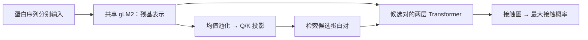

# FlashPPI 模型改进讨论与实验计划

记录日期：2026-10-11。依据上一轮源码审查、CPU 最小验证及已完成的 head-only 实验整理。

本文记录已确认的实现行为、待验证的改进假设和建议实验顺序。新增方案尚未实施；本文不改变现有训练任务、配置或模型权重。

## 1. 目标与边界

目标分为两部分：先提高蛋白对互作预测性能，再改进模型并用于大规模互作筛选。

- 保持现有接触预测网络结构，以及 `sigmoid(max(valid contact logits))` 互作打分公式。
- 原始数据库 `/media/zlab/lexar4t/ppidb/distributions/ppidb-training-20261009_101259` 只读。
- 官方 E. coli test 的样本和标签固定；不使用 test 选择改进方案、超参数或 checkpoint。
- 保留现有固定 val；全部 500 个正对用于接触图评估，可靠映射的固定子集用于互作 AP。
- 已启动的界面裁剪 LoRA 与匹配 head-only 对照保持其固定配置，新方案另建实验。

总体判断：**短期互作 AP 优先检查负样本与训练目标；结构改进优先考虑界面感知的检索表示。** 这些是实验优先级，不是已证明的性能提升。

## 2. 源码覆盖与实际模型路径

审查覆盖仓库 28 个 Python 文件、官方模型的 3 个运行源码文件，以及训练配置、文档和已有实验报告。

| 范围 | 主要文件 |
| --- | --- |
| 模型与层 | `flashppi/model.py`、`flashppi/layers.py`、`flashppi/config.py` |
| 数据、损失与训练 | `flashppi/dataset.py`、`flashppi/cropping.py`、`flashppi/loss.py`、`flashppi/train.py`、`flashppi/finetune.py`、`flashppi/lora.py` |
| 评估与筛选 | `flashppi/eval.py`、`predict_proteome.py`、`predict_cross_proteome.py` |
| 支撑流程 | `tools/` 下的数据划分、验证集准备、评估、审计、实验执行与汇总脚本，以及 `tests/` 下的回归检查 |
| 当前官方运行模块 | `artifacts/flashppi_official/flashppi_noecoli/` 下的 `modeling_flashppi.py`、`configuration_flashppi.py`、`glm_tokenizer.py` |

当前微调通过 [finetune.py](../flashppi/finetune.py) 的 `load_released()` 加载官方模型，再由 `ReleasedTrainingModel` 复用官方骨干和预测头。**只修改仓库内同名的 `ContrastiveHead`，不会自动替换当前微调使用的模块。** 后续结构实验必须明确接入实际训练和导出路径，并验证保存、重载的一致性。

上述图表示筛选流程。目前官方 test 评估对每个给定蛋白对直接计算接触分数，不经过检索候选过滤。因此，在骨干和接触头固定时，仅修改检索头不会改变这个 test 的主互作 AP；其直接收益应通过检索召回率和完整筛选流程评估。

## 3. 已有实验提供的线索

以下是已经完成的旧版 head-only 实验，使用前缀裁剪，不代表新界面裁剪 LoRA 的结果。

| 模型 | val 互作 AP | val 接触 P@K | val CLIP AP |
| --- | ---: | ---: | ---: |
| 官方起点 | 0.567471 | 0.226836 | 0.645173 |
| BS64 final | 0.503628 | 0.249313 | 0.692233 |
| BS1024 final | 0.525571 | 0.237629 | 0.658151 |

观察：接触定位与 CLIP 排序改善，但最终互作 AP 下降。由此优先检查负样本、训练目标与最大接触分数的匹配程度。旧版前缀裁剪也存在干扰，不能把下降直接归因于某一种损失或模块。

head-only 模式下骨干冻结，两项损失主要更新各自的头，耦合包括离散的难负例选择。不能仅凭损失数值大小断言共享表示出现梯度冲突；LoRA 开启后才需要进一步检查共享骨干上的梯度关系。

证据：[完整实验报告](../runs/finetune_complete_results/REPORT.md)、[验证与采样诊断](../runs/finetune_followup/diagnostics/REPORT.md)。

## 4. 优先改进接触负样本

### 已确认的行为

有效 batch=1024 扩大了 CLIP 的对比池，双向后有 2048 个条目；接触头挖掘难负例仍局限于微批。微批为 16 时，双向候选池只有 32 个条目，而且不保证条目对应不同蛋白。

`get_contact_negatives()` 先选 hard-negative，再追加 self-negative。双向池中的 `(A,A)` 可能已被前者选中，随后又被后者追加。CPU 构造例子得到 12 个负对、8 个不同的有序负对，其中 4 个 self-negative 各出现两次。这证明重复加权路径存在，不代表实际训练中的重复比例已测定。

来源：[model.py](../flashppi/model.py) 的 `get_contact_negatives()` 与 `FlashPPIModel.forward()`。

### 改进策略

1. 先审计并明确 hard/self 负对去重策略，同时记录实际数量和难度分布。
2. 单独比较全有效 batch 的难负例挖掘：缓存 CLIP 向量、选择负对，再按小微批计算接触损失。
3. LoRA 训练时分批重新编码所选蛋白，保留所需梯度，避免长期缓存全 batch 的带梯度残基表示。
4. 保持已知正互作屏蔽；未知自互作不能直接视为已证实阴性，self-negative 比例值得另做消融。
5. 在可靠物种映射可用时，比较同物种、长度匹配的负例策略，避免把容易的跨物种负对当作主要改进来源。

扩大候选范围与增加微批显存占用是不同操作。负例去重、扩大候选池和改变物种约束应分别实验，避免无法归因。

## 5. 让训练目标更匹配互作排序

### 接触监督与蛋白对判断

当前 focal loss 监督残基对，最终互作分数由最大有效接触 logit 决定。现有损失会惩罚错误接触，但没有单独的蛋白对分类或排序约束。因此，接触图整体改善不必然带来互作 AP 改善。

建议独立测试小权重的 pair-level 损失：仍以原有最大有效 logit 为输入，增加蛋白对分类或正负排序约束。可先检查加强负对高分尖峰约束的效果，同时监测接触 P@K，防止过强约束损害定位能力。

这只改变训练约束，保留接触网络、输出接触图和推理打分公式。尚无本项目实验结果证明附加损失有效。

### 微批归一化

当前先用每个微批的正接触数归一化 focal loss，再按微批样本数加权。对同一批数据，改变分组会改变目标函数。

CPU 最小例子使用两个 2×2 接触图、全零 logits、分别 1 个与 4 个正接触：整批计算损失约为 0.121301；拆成两个等权微批则约为 0.238269。该差异不依赖负样本挖掘。

建议将“按整个有效 batch 的有效正接触总数归一化”作为独立对照。验证归一化实现时必须固定负对清单，再比较不同 chunk 下的损失和梯度；否则负例池变化仍会混入比较。统一分母不是所有任务的必然最优解，应结合训练稳定性与 val 表现判断。

来源：[loss.py](../flashppi/loss.py) 的 `focal_loss()`、`ContactLoss` 和 `PPIGradientCache.step()`。

## 6. 模型结构首选：界面感知的检索表示

### 单向量可学习池化

当前官方检索头对所有有效残基均值池化，再经过 Q/K 投影得到检索向量。长蛋白、多结构域蛋白中的小界面信号可能被其他位置稀释；这是待验证假设，不能据此断言均值池化必然丢失界面信息。

第一版保留原均值表示，增加可学习的残基加权分支，以零门控初始化，随后学习哪些位置更有助于检索。Q/K 输出维度保持不变，先隔离池化改动的效果。

已有接触标签可以提供训练期界面弱监督，但要注意：当前复合物中没有接触的残基，不代表它不会结合其他伙伴。可以聚合同一序列已观察到的界面，并处理缺失坐标，避免将其余位置全部标成“永不结合”。

推理时只读取单条蛋白序列，不依赖真实接触标签或已知结合伙伴，仍支持提前编码建库。

### 多界面向量

若单向量改动有效，再考虑每条蛋白输出 4–8 个界面向量，分别检索并合并候选，适应多伙伴、多界面的情形。需要在相同候选总预算下比较召回，并计入索引空间和计算成本；不能仅靠扩大候选数量宣称模型变好。

隔离检索头实验时主要观察 Recall@K。若随后联合 LoRA 更新共享骨干，再独立判断是否改善直接配对的互作 AP。

来源：[官方 ContrastiveHead](../artifacts/flashppi_official/flashppi_noecoli/modeling_flashppi.py)。方法参考：[Attention-based Deep Multiple Instance Learning](https://arxiv.org/abs/1802.04712)；该论文提供可学习池化思路，不构成本项目性能提升的证据。

## 7. 多伙伴监督、结构重复与长链视图

### 多正例对比学习

目前 InfoNCE 以对角配对为正例，其他已知互作主要通过屏蔽避免误罚。可比较让同一蛋白的多个已知伙伴共同参与正例监督的目标。

正例集合应来自真实已知蛋白对；同源簇关系继续用于屏蔽，不能自动把同簇相关配对全部升级成正标签，也不能假设互作关系具有传递性。

来源：[loss.py](../flashppi/loss.py) 的 `mask_false_negatives()` 与对比损失。

### 在簇内先选择序列对

当前采样顺序为“蛋白簇 → 结构记录”。同一序列对拥有更多结构时，仍可能获得更大权重。可比较“蛋白簇 → 不同无序序列对 → 该对的结构”，减少结构重复偏置，同时保留不同构象。

原始训练候选在零接触过滤前为 1,120,675 条结构记录、153,001 个不同无序序列对；不能把结构记录数直接当作独立生物学互作数。采样策略实验只改变读取方式，不修改原数据库或冻结划分。

来源：[dataset.py](../flashppi/dataset.py) 的 `ClusterSampler`。

### 裁剪与全长之间的差异

新界面裁剪已经解决验收样本中的有效接触全部丢失问题，但训练输入是由已知伙伴界面决定的局部窗口，部署时通常只有全长序列。这个输入分布差异仍然存在。

后续可用少量全长训练，或全长与裁剪视图的一致性训练检验其影响。不同界面可能对应不同伙伴，不应未经验证就强迫所有局部界面具有完全相同的表示。

界面裁剪现有实现与验收见 [INTERFACE_CROPPING.md](INTERFACE_CROPPING.md)。裁剪保留率提升是数据处理质量证据，不等于预测性能已提升。

## 8. 微调配置的改进空间

当前固定 LoRA 配置包含 327,680 个适配器参数，总可训练参数为 62,599,690；约 62,272,010 个参数属于原有预测头与温度参数。骨干原权重冻结，但训练并非只有 LoRA 在更新。

目前所有可训练参数使用同一学习率，warmup 为短实验沿用的 3.125 步，之后保持固定学习率。在 2,150 步预算下，warmup 仅约占 0.15%。

建议分别比较头部/LoRA 学习率分组，以及适合长程训练的 warmup 与衰减方案。补充各模块梯度、相对权重变化量后，再决定是否增大 LoRA rank 或覆盖更多层。参数数量本身不能证明某一模块主导了更新。

来源：[finetune.py](../flashppi/finetune.py)、[固定 LoRA 配置](../configs_train/finetune_lora_bs1024_micro16_interface_v2.json)。这些是后续对照项，不中途修改本轮配置。

## 9. 大规模筛选与评估补充

### 检索复杂度与显存

两个筛选脚本使用 `IndexFlatIP`，属于精确穷举检索。对 N 条蛋白执行全库查询时，向量比较仍约为 O(N²d)，其中 d 是向量维度；送入接触头的候选数量约为 O(NK)。不能把当前脚本所有阶段都称为严格线性。

更大规模时可比较 HNSW/IVF，同时测量近似检索相对于精确检索的召回损失。单蛋白组脚本还把全部残基表示保留在 GPU，后续需要 CPU/磁盘缓存与按需搬运。

跨蛋白组脚本每个病毒蛋白只输出一个最佳宿主匹配。用于完整互作网络时，应增加保存全部合格候选的输出方式，并固定方向和去重规则，避免无意改变打分协议。

来源：[predict_proteome.py](../predict_proteome.py)、[predict_cross_proteome.py](../predict_cross_proteome.py)、[FAISS 官方索引说明](https://github.com/facebookresearch/faiss/wiki/Faiss-indexes)。

### 补充检索与分组指标

在固定候选背景下记录 Recall@20/50/100，区分“真互作没有被检索到”与“接触头判断错误”。不同检索方案使用同样的候选预算、背景与已知正例定义。

固定 AP val 包含 81 个正例、4,119 个推定负例。其中人类正例 49 个，占 60.49%；人类负例 3,923 个，占 95.24%。整体 AP 受这一物种构成影响，不能独立代表广泛物种筛选能力。

保留当前 val，同时补充分物种、分长度、分界面规模的描述性结果。小分组与单随机种子的小幅变化不能直接视为稳定收益；负对仍是推定阴性。

来源：[验证集 manifest](../data/ppi_finetune_validation_v1/manifest.json)。

## 10. 建议实验顺序与验收

现有界面裁剪 LoRA 与匹配 head-only 先按原计划形成对照。下面各项先用相同短训练预算独立比较，再决定哪些值得长程复验。

| 顺序 | 独立实验 | 主要判断依据 |
| --- | --- | --- |
| 1 | hard/self 负对去重 | 负例组成、实际重复率、val AP 与接触 P@K |
| 2 | 接触损失归一化对照 | 固定负对下不同微批的梯度一致性、训练稳定性与 val 指标 |
| 3 | 扩大接触难负例候选池 | 负例难度、负对高分尾部、val AP、显存与耗时 |
| 4 | 小权重 pair-level 训练约束 | 互作 AP 改善，同时接触定位保持 |
| 5 | 界面感知单向量池化 | 固定背景下 Recall@K，特别是长链和小界面样本 |
| 6 | 多界面向量与近似检索 | 相同候选预算下的召回、完整筛选效果、速度与内存 |

学习率分组、多正例监督、序列对采样和全长视图属于另行安排的独立消融，不与上述主变量一起更改。

共同验收原则：

- 除被比较的变量外，固定初始化、数据划分、采样预算、微批及评估协议；必须改变关联条件时明确记录。
- 以 val 筛选方案，并与第 0 步官方起点比较；“本轮 best”不自动意味着优于官方模型。
- 同时记录互作 AP、接触 P@K、检索指标和资源开销，区分准确率收益与工程加速。
- 新模型模块验证前向接入、有效梯度、冻结参数、保存重载与恢复训练；全局负例流程验证负例屏蔽及分批梯度。
- 方案和 checkpoint 的选择固定后，再按约定报告官方 test，不能反过来用 test 调整方案。

## 11. 本次记录的完成状态

- 已完成源码静态通读、已有实验核对，以及两个 CPU 最小验证。
- CPU 验证确认微批分组影响当前 focal 目标，以及 hard/self 负例存在重复路径；未据此断言它们是 AP 下降的根因。
- 本次文档整理没有启动新训练、修改模型源码、修改配置、修改数据或覆盖 `AGENTS.md`。
- 本文中的新增策略仍是待验证方案；训练实时进度与最终结果以对应 run 的状态、日志和报告为准。
